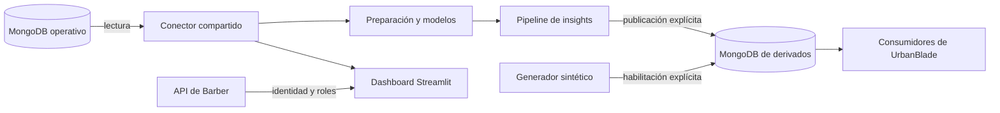

# Arquitectura y gobierno de datos

## Responsabilidades

Barber conserva la identidad y la fuente de verdad operativa. El conector Spark
lee colecciones operativas; no migra, modifica ni reemplaza esos registros.
Los derivados son reconstruibles y tienen ciclo de publicación independiente.

## Conexiones

[settings.py](../config/settings.py) valida las variables sin conectar al importarse:

| Contexto | Configuración |
| --- | --- |
| Core | CORE_MONGODB_URI, o MONGO_USER/PASSWORD/CLUSTER y MONGO_DB. |
| Derivados | ANALYTICS_MONGODB_URI, o ANALYTICS_MONGO_USER/PASSWORD/CLUSTER y ANALYTICS_MONGO_DB. |
| Archivo privado | URBANBLADE_ENV_FILE o --env-file en los comandos que lo aceptan. |

La URI y la base deben coincidir si ambas especifican nombre. Se rechazan bases de
sistema y se exige una base analítica distinta. No se usa MONGODB_URI del backend
como fallback: puede representar una identidad con privilegios de escritura.

Estas guardas no conceden ni revocan permisos remotos. La identidad core debe tener
lectura efectiva; la analítica, escritura limitada a derivados. El diagnóstico
revisa privilegios sin listar usuarios, contraseñas o registros del negocio.
La representación de configuración oculta la URI; los errores no copian sus valores.

## Acceso al dashboard

[barber_auth.py](../config/barber_auth.py) usa los endpoints existentes de login,
usuario y logout. Los roles autorizados son administrador e ingeniero. El rol
conserva su nombre real; «Analista» es una etiqueta de presentación.

El dashboard no compara hashes ni obtiene credenciales OAuth de Google. La
revocación del token es un intento de mejor esfuerzo, como en el flujo previo;
no se afirma que cierre sesiones de terceros si la API no responde. El healthcheck
solo comprueba respuesta HTTP de Streamlit, no autenticación ni calidad de datos.

## Lectura, transformación y privacidad

[get_spark_session](../config/mongo_spark_conexion_sinnulos.py) conserva la firma
(spark, df, df_vector). Resuelve citas, servicios y perfiles mediante referencias
reales; cliente se obtiene por clients.user_id y barbero por barbers.user_id.
Se normalizan Decimal128, nulos y valores numéricos no finitos. Los datos no válidos
no se convierten en una justificación para escribir o corregir el core desde Spark.

Los análisis pueden manejar nombres y otros datos de negocio en memoria y producir
archivos locales. El acceso a esa información debe estar autorizado y sus salidas
no se publican como fixtures o artefactos de CI. Los modelos se tratan como material
privado; no cargar archivos serializados de origen desconocido.

## Publicación y contrato

[publicar_insights.py](../pipelines/publicar_insights.py) calcula un snapshot y lo
publica solo con --publish y ALLOW_ANALYTICS_PUBLICATION=true. El helper crea una
colección temporal, inserta e indexa y renombra sobre analytics_insights; si falla,
retira únicamente la temporal. Un snapshot vacío no borra el último conocido.

Se conservan tipo, roles, identificadores de barbero, categoría, datos de gráfica,
contenido y generado_en. El campo legado unidad permanece por compatibilidad del
consumidor; no organiza el producto ni se elimina sin coordinar su contrato con Barber.
No se crea una colección paralela dentro del core.

El generador escribe únicamente appointments_synthetic, exige --apply más
ALLOW_SYNTHETIC_WRITES=true y no ejecuta escrituras al importarse. Las pruebas de
integración aceptan solo Mongo loopback sin credenciales y bases propias *_e2e.

## Decisiones de evolución

- Mantener Spark 3.5 con su último parche compatible y Java 17; no mezclar la
  reorganización con un salto a Spark 4 que necesita evaluación de API y modelos.
- Mantener pandas 2.x y NumPy 1.x en este runtime; sus saltos mayores requieren pruebas.
- Separar dashboard de frameworks opcionales de entrenamiento para reducir superficie.
- Mantener comandos ejecutables detrás de main; importar un análisis no inicia trabajo.
- Conservar postmortems y contratos de consumidores al retirar entregables académicos.

No se cambia el esquema de Barber ni se capturan nuevos eventos para un funnel.
Esas decisiones necesitan requisitos, privacidad y coordinación independientes.
